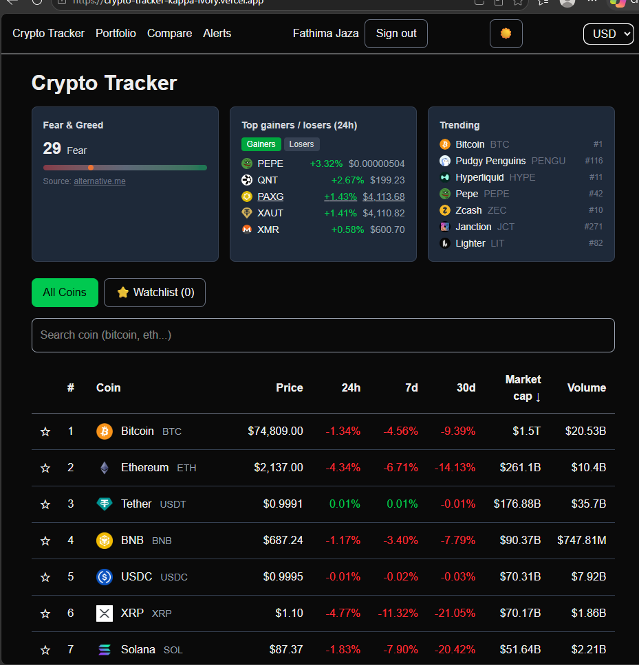
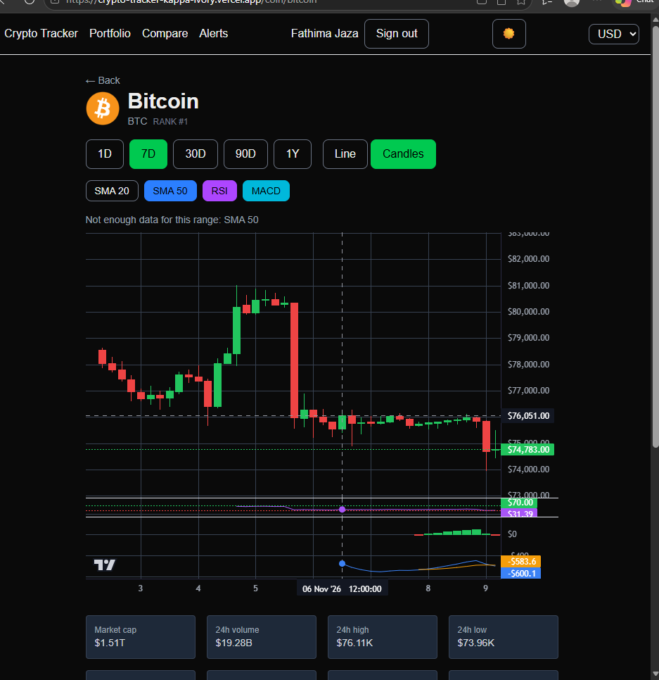
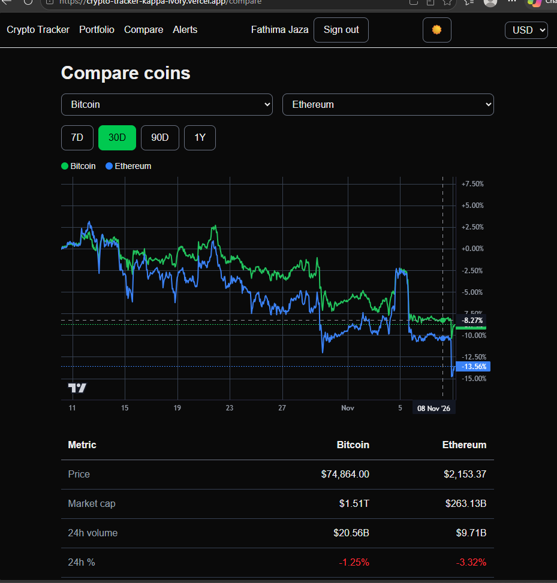
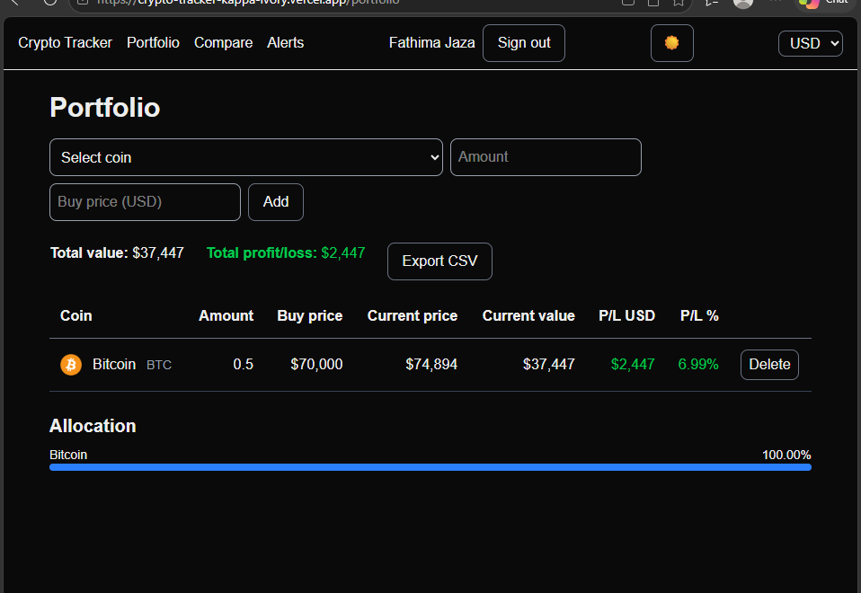
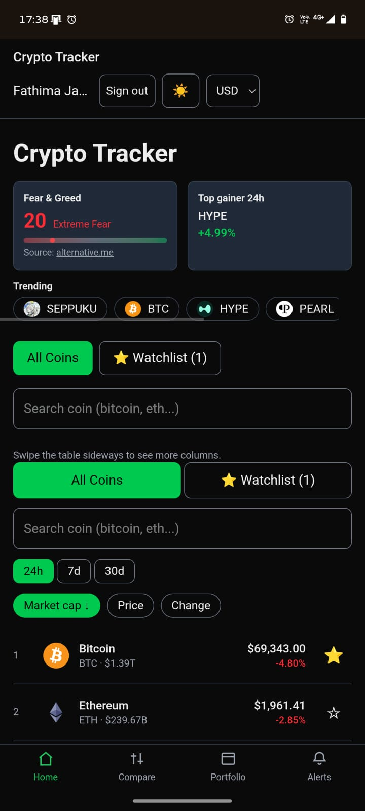
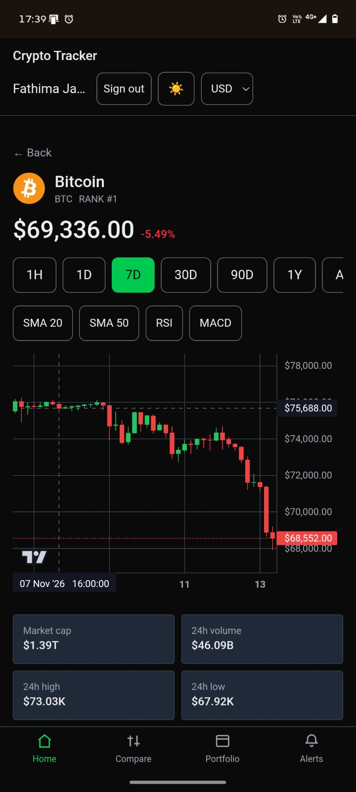
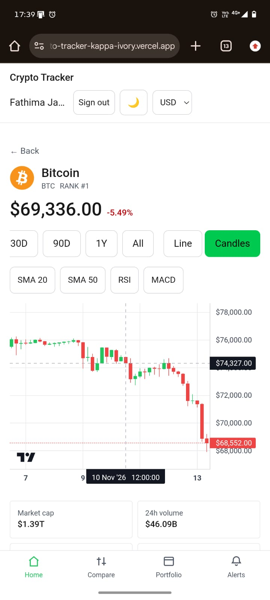

# Crypto Tracker

[](https://github.com/Cleopatra-Jaza/crypto-tracker/actions/workflows/ci.yml)

Real-time cryptocurrency tracker built with Next.js.

**Live demo:** https://crypto-tracker-kappa-ivory.vercel.app

## Features

### Market
- Live prices for the top 50 coins with sorting and market cap, volume, 7d, and 30d columns.
- Live USD prices over a Binance public WebSocket for top coins (market cap rank <= 300), with a green "Live" indicator and polling fallback.
- Search across all coins.
- Fear & Greed Index.
- Trending coins.
- Top gainers and losers.
- Multi-currency support: USD, LKR, AED, EUR, GBP, INR.

### Coin page
- Stats, ATH/ATL, and supply.
- Description.
- Line and candlestick charts.
- SMA, RSI, and MACD indicators.
- Live last bar on the 1H and All charts (USD) following the live price.

### Compare
- Compare two coins with a percent-change chart and stats side by side.

### Accounts
- GitHub and Google sign-in with Auth.js.
- Watchlist synced across devices.
- Portfolio with profit/loss and allocation.
- CSV export.
- Price alerts with in-app checks while the site is open and optional email alerts.

### News
- News page with headlines and short summaries from public RSS feeds of Cointelegraph and CoinDesk.
- Links open the publisher's own site.

### Alerts
- In-app alert checks run every minute while the site is open in a browser tab.
- Optional "Also email me" alerts (see "How email alerts work" below).

### Experience
- Phone-first layouts with a bottom navigation bar.
- Light and dark themes.
- Skeleton loaders and price flash.
- Installable PWA with app icons/logo and manifest.
- Responsive layout.
- Privacy and terms pages.

## How email alerts work

- The alert form includes an **"Also email me"** option when creating a price alert.
- A secured server route (`/api/cron/check-alerts`, protected by a secret bearer token) is called by a free external scheduler (cron-job.org) about every 15 minutes. (Vercel Hobby cron runs only once a day.)
- Each run makes price requests for due coins, checks alerts, claims each alert atomically in the database so an alert is never emailed twice, and sends messages through Brevo.
- Limits enforced in code: up to 25 email attempts per run, up to 250 emails per UTC day, and at most 10 active email alerts per user (with at most 20 active alerts total per user).
- **Limitations:** without a custom domain, emails are sent from a free shared sender and can land in the spam folder; checks run about every ~15 minutes so emails can arrive late (this also helps keep the free Neon database within its monthly compute allowance). Email delivery is best effort.

## Architecture notes

- All third-party API calls go through server-side API routes with caching and stale-fallback handling; the CoinGecko API key stays on the server.
- Shared cache with Upstash Redis for the coin list, with an in-memory cache layer in front (`lib/cache.ts`); other API routes also use server-side caching/revalidation where configured.
- The Binance WebSocket hook (`lib/useLivePrices.ts`) subscribes to miniTicker streams, throttles/buffers updates, pauses when the tab is hidden, and reconnects with exponential backoff.
- Images use `next/image` with `unoptimized` in the UI.
- Database migrations are additive and applied before code that depends on them is deployed.

## Tech stack

Next.js (App Router), TypeScript, Tailwind CSS, Lightweight Charts, Auth.js, Prisma 7, PostgreSQL (Neon), Upstash Redis, Brevo, Vitest, GitHub Actions, Vercel, CoinGecko API, alternative.me Fear & Greed API, Binance WebSocket, Cointelegraph/CoinDesk RSS feeds.

## Environment variables

List variable names only; never commit real values.

- `AUTH_GITHUB_ID` — GitHub OAuth app client ID
- `AUTH_GITHUB_SECRET` — GitHub OAuth app client secret
- `AUTH_GOOGLE_ID` — Google OAuth app client ID
- `AUTH_GOOGLE_SECRET` — Google OAuth app client secret
- `AUTH_SECRET` — secret used by Auth.js to sign/encrypt session data
- `BREVO_API_KEY` — Brevo API key for sending alert emails (server-side)
- `BREVO_SENDER_EMAIL` — sender email address for Brevo
- `BREVO_SENDER_NAME` — sender display name for Brevo
- `COINGECKO_API_KEY` — CoinGecko API key (server-side only)
- `CRON_SECRET` — bearer token used to authorize the cron email-alert route
- `DATABASE_URL` — PostgreSQL connection string (Neon)
- `UPSTASH_REDIS_REST_TOKEN` — Upstash Redis REST token for shared cache
- `UPSTASH_REDIS_REST_URL` — Upstash Redis REST URL for shared cache

## Run locally

```bash
npm install
npm run dev
```

## Screenshots


*Home: Fear & Greed, gainers/losers, trending and the live price table*


*Coin page: candlestick chart with RSI and key stats*


*Compare: percent-change chart and stats side by side*


*Portfolio: holdings, profit/loss and allocation*

### Phone

<table>
  <tr>
    <td align="center">
      <br />
      <em>Phone: market overview and coin list with bottom navigation</em>
    </td>
    <td align="center">
      <br />
      <em>Phone: coin page with chart and range buttons</em>
    </td>
    <td align="center">
      <br />
      <em>Phone: light mode</em>
    </td>
  </tr>
</table>

## Testing

Unit tests (Vitest) cover indicators, currency formatting, CSV export, the live-price stream builder, the news feed parser, the alert email builder, and the cron token check (about 72 tests). They run with `npm test` and in GitHub Actions (`.github/workflows/ci.yml`) on every push (type check, lint, tests, build).

## Known limitations

- Free-tier API limits (e.g. CoinGecko rate limits) can cause temporary errors or stale data.
- Email alerts may arrive late or land in the spam folder; delivery is best effort.
- Live prices are available only for USD and for coins available on Binance streams.

## Credits

Data: CoinGecko. Fear & Greed Index: alternative.me.
