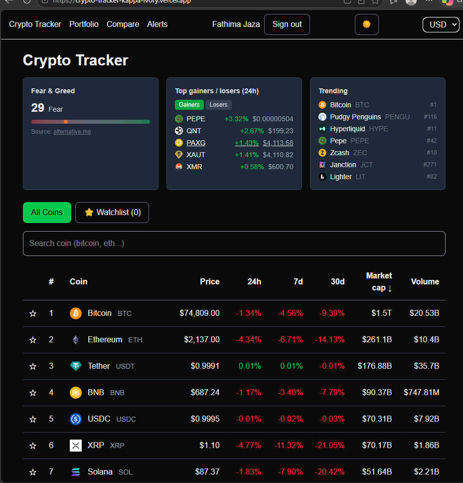
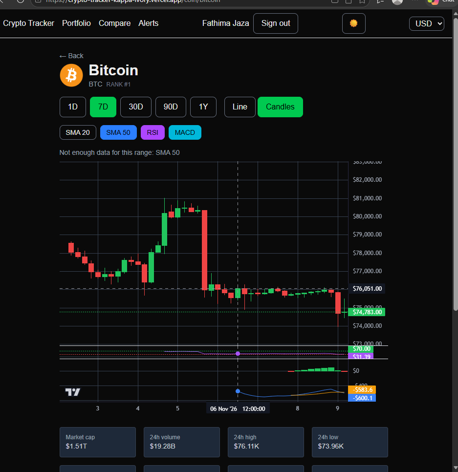
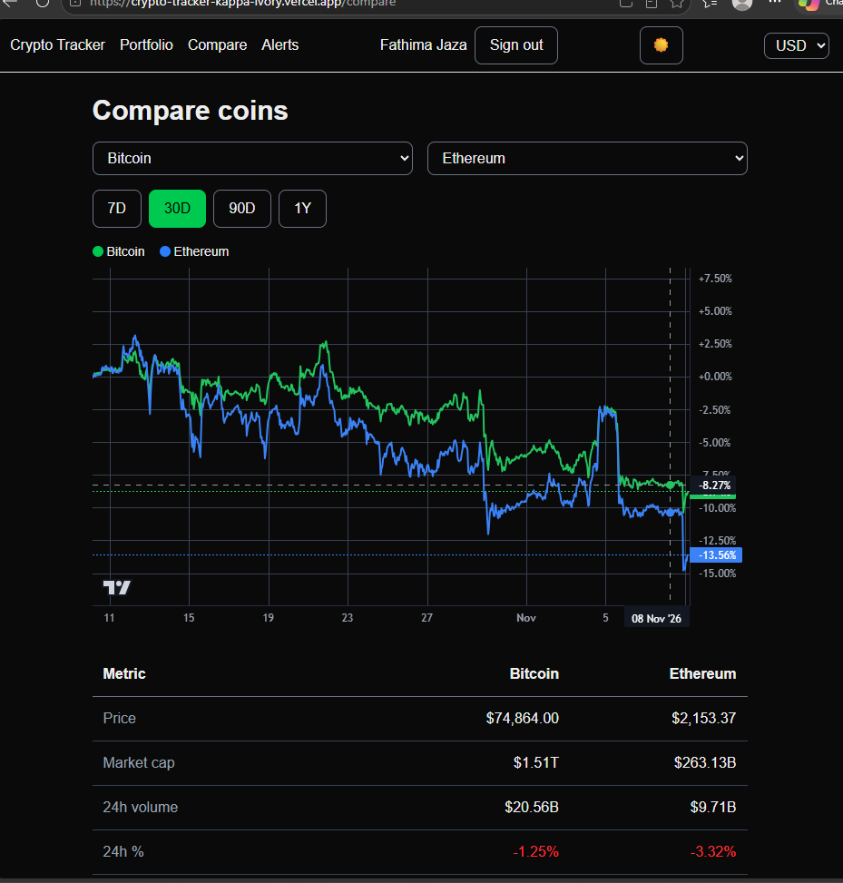
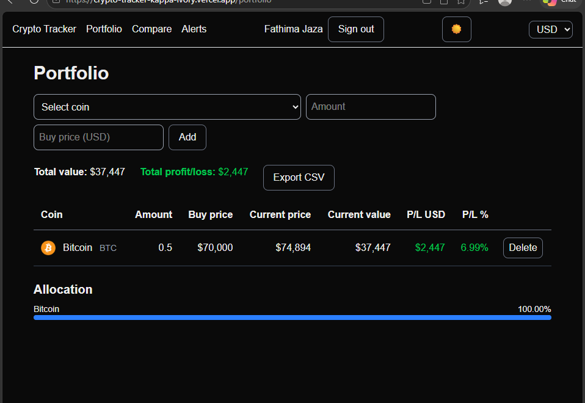

# Crypto Tracker

Real-time cryptocurrency tracker built with Next.js.

**Live demo:** https://crypto-tracker-kappa-ivory.vercel.app

## Features

- **Market**
  - Live prices for the top 50 coins with sorting and market cap, volume, 7d, and 30d columns
  - Fear & Greed Index
  - Trending coins
  - Top gainers and losers
  - Multi-currency support: USD, LKR, AED, EUR, GBP, INR
- **Coin page**
  - Stats, ATH/ATL, and supply
  - Description
  - Line and candlestick charts
  - SMA, RSI, and MACD indicators
- **Compare coins**
  - Percent-change chart and stats side by side
- **Accounts**
  - GitHub sign-in with Auth.js
  - Watchlist synced across devices
  - Portfolio with profit/loss and allocation
  - CSV export
  - Price alerts checked while the site is open
- **Experience**
  - Dark/light mode
  - Skeleton loaders
  - Price flash
  - Installable PWA
  - Responsive layout

## Tech stack

Next.js (App Router), TypeScript, Tailwind CSS, Lightweight Charts, Auth.js, Prisma 7, PostgreSQL (Neon), Vercel, CoinGecko API, alternative.me Fear & Greed API.

## How it works

All CoinGecko calls go through server-side API routes with caching, stale fallback, and rate-limit handling. The CoinGecko API key stays on the server and is never exposed to the browser.

## Environment variables

List the variable names only; never commit real values.

- `DATABASE_URL` — PostgreSQL connection string (Neon)
- `AUTH_SECRET` — secret used by Auth.js to sign/encrypt session data
- `AUTH_GITHUB_ID` — GitHub OAuth app client ID
- `AUTH_GITHUB_SECRET` — GitHub OAuth app client secret
- `COINGECKO_API_KEY` — CoinGecko API key (server-side only)

## Run locally
npm install
npm run dev

## Screenshots

*Home: Fear & Greed, gainers/losers, trending and the live price table*

*Coin page: candlestick chart with RSI and key stats*

*Compare: percent-change chart and stats side by side*

*Portfolio: holdings, profit/loss and allocation*

## Credits

Data: CoinGecko. Fear & Greed Index: alternative.me.
